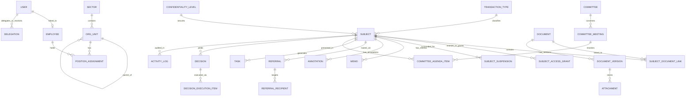
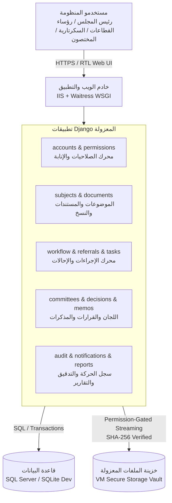
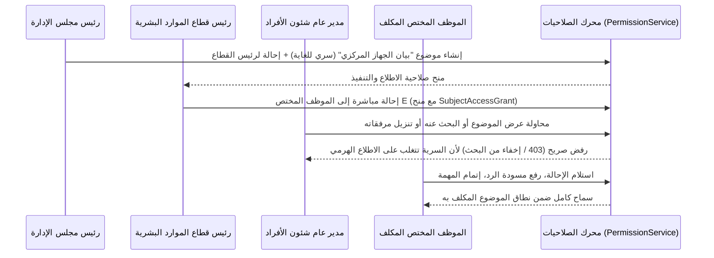

# الوثيقة المعمارية والتحليلية — المرحلة الأولى
**منظومة إدارة السكرتارية والمراسلات والأرشفة والدورة المستندية**

---

## 1. ملخص فهم المشروع والمتطلبات
تهدف المنظومة إلى إدارة دورة الحياة التشغيلية الكاملة للموضوعات والمعاملات الإدارية داخل الشركة (بدءاً من قطاع الموارد البشرية مع قابلية التوسع لقطاعات أخرى دون تعديل الكود)، بحيث يتم الفصل الصارم بين:
- **الموضوع (Subject)**: الملف الرئيسي الجامع للمعاملة.
- **المستند (Document)**: الوثيقة الواردة/الصادرة/الداخلية المرتبطة بعلاقة Many-to-Many مع الموضوعات وبإصدارات غير قابلة للاستبدال.
- **الإحالة (Referral)**: حركة التوجيه (مباشرة / متتابعة / متوازية / للعلم فقط).
- **المهمة (Task)**: التكليف التنفيذي المحدد بمسؤول وموعد استحقاق.
- **القرار والتنفيذ (Decision & Execution)**: فصل إصدار القرار واعتماده عن توزيعه ومتابعة تنفيذه من جهات متعددة.

---

## 2. مخطط الكيانات والعلاقات (ERD)

---

## 3. مخطط البنية المعمارية (C4 Container Architecture)

---

## 4. مخطط تسلسل الإجراءات للسيناريو الأول والخامس (Sequence Diagrams)

### أ) السيناريو الخامس: بيان عاجل وسري للغاية (اختبار نموذج الأمان)

---

## 5. مصفوفة الصلاحيات الأساسية (Permissions Matrix)

| الإجراء / الصلاحية | رئيس المجلس | رئيس القطاع | السكرتارية المفوّضة | المدير العام | المشرف / رئيس القسم | الموظف المختص |
| :--- | :---: | :---: | :---: | :---: | :---: | :---: |
| إنشاء موضوع / تسجيل مستند | نعم | نعم | حسب التفويض | نعم | نعم | مقيد |
| الاطلاع الهرمي على الموضوعات العادية | نعم | داخل قطاعه | داخل نطاق التفويض | داخل إدارته | داخل قسمه | المكلف بها فقط |
| الاطلاع على موضوع سري / سري للغاية | بتصريح صريح أو طرف مباشر | بتصريح صريح أو طرف مباشر | بتفويض صريح للسرية فقط | **ممنوع ما لم يُحل إليه أو يُصرّح له** | **ممنوع ما لم يُحل إليه** | المكلف به فقط |
| إحالة موضوع (مباشرة / متتابعة / متوازية) | نعم | نعم | بالنيابة وفق التفويض | نعم | نعم | إعادة/رد فقط |
| إعداد مذكرة عرض / رأي | نعم | نعم | نعم (مسودة) | نعم | نعم | نعم |
| تسجيل تأشيرة إدارية / اعتماد | نعم | نعم | لا (تسجيل ورقي نيابة فقط) | ضمن صلاحيته | لا | لا |
| إصدار قرار إداري واعتماده | نعم | حسب التفويض | لا | لا | لا | لا |
| تنفيذ قرار وإرفاق الإثبات | متابعة | متابعة | متابعة | متابعة | مراجعة | نعم |
| إغلاق موضوع رسمي / إعادة فتح | نعم | نعم | لا | بشروط الإغلاق | لا | لا |

> **القاعدة الحاكمة:** يتم التحقق من كل صلاحية داخل الخادم في `accounts/services.py` (`PermissionService`) ولا يُكتفى بإخفاء عناصر الواجهة.

---

## 6. حالات الموضوع والمهمة والمستند (State Machines)

- **حالات الموضوع (`Subject.status`)**: `NEW` (جديد) ← `INCOMING` (وارد) ← `UNDER_REVIEW` (قيد المراجعة) ← `IN_PROGRESS` (قيد التنفيذ) ← `AWAITING_APPROVAL` (في انتظار اعتماد) / `AWAITING_COMMITTEE` (في انتظار لجنة) / `SUSPENDED` (معلق للاستيفاء) ← `DECISION_ISSUED` (صدر القرار) ← `DISTRIBUTING` (قيد التوزيع) ← `FINAL_EXECUTION` (قيد التنفيذ النهائي) ← `COMPLETED` (مكتمل) ← `CLOSED` (مغلق) — مع دعم `REOPENED` و `REJECTED` و `CANCELLED`.
- **حالات المهمة (`Task.status`)**: `NEW`, `RECEIVED`, `IN_PROGRESS`, `PAUSED`, `WAITING_EXTERNAL`, `COMPLETED`, `REJECTED`, `CANCELLED`.
- **حالات القرار (`Decision.status`)**: `DRAFT`, `UNDER_REVIEW`, `APPROVED`, `ISSUED`, `DISTRIBUTING`, `EXECUTING`, `COMPLETED`, `CANCELLED`.

---

## 7. ما تم تنفيذه وما تم تأجيله للمراحل اللاحقة

### الميزات المنفذة فعلياً في هذا الإصدار:
1. الهيكل التنظيمي الديناميكي متعدد القطاعات (بدءاً بقطاع الموارد البشرية) وفصل الموظف عن المستخدم والمنصب.
2. نظام الصلاحيات متعدد الأبعاد وعزل السرية الفائق (السرية تغلب التدرج الهرمي).
3. نظام السكرتارية والإنابة المؤقتة مع تسجيل الفاعل الأصلي والمُفوَّض في سجل الحركة.
4. نموذج الموضوع المستقل والمستند المرتبط بعلاقة Many-to-Many وإدارة النسخ والمرفقات المعزولة ببصمة `SHA-256`.
5. محرك الإحالات الحر (المباشرة، المتتابعة، المتوازية، وللعلم فقط) وقوالب المسارات المؤرخة بإصدارات (`WorkflowTemplateVersion`).
6. إدارة المهام المستقلة ومواعيد الاستحقاق والتعليق والاستيفاء وإعادة الفتح والإغلاق المشروط.
7. المذكرات والتأشيرات واللجان والقرارات ومتابعة تنفيذ القرارات بجهات متعددة، مع قوالب طباعة رسمية RTL.
8. سجل الحركة التاريخي غير القابل للحذف (`ActivityLog`) وسجل التدقيق الأمني (`AuditLog`) والبحث المتقدم والتقارير وتصدير CSV.
9. اختبارات آلية تغطي السيناريوهات الخمسة وحالات الأمان والتزامن.

### الميزات المؤجلة (طبقاً لنطاق المرحلة الأولى في الوثيقة):
1. التكامل المباشر عبر API مع أنظمة الموارد البشرية والرواتب القائمة (جاهز لإضافة طبقة التكامل مستقبلاً).
2. التوقيع الإلكتروني المشفر المعتمد قانونياً (PKI/Token).
3. إرسال التنبيهات عبر خادم البريد SMTP أو الرسائل النصية (الإشعارات داخل النظام مفعّلة ومعزولة عن المعاملات).
