# مخطط قاعدة البيانات الشامل (ERD) — منظومة السكرتارية والمراسلات والأرشفة

يعكس هذا المرجع البنية الفعلية لقاعدة البيانات في التطبيق (`Django 5.1.x`) عبر **12 تطبيقاً** و **49 نموذج بيانات (Model)** كما تم فحصها مباشرة من ملفات `models.py`، ويشمل المفاتيح الأساسية (`PK`) والخارجية (`FK`) وعلاقات `One-to-Many` و `Many-to-Many` وقواعد `on_delete` والفهارس وقيود التفرد (`unique_together`) وآلية الترقيم المتزامن والسجلات غير القابلة للحذف.

---

## 1. المخطط الكياني العلائقي (Mermaid ERD)

```mermaid
erDiagram
    Sector ||--o{ OrgUnit : "يحتوي"
    OrgUnitType ||--o{ OrgUnit : "يصنف"
    OrgUnit ||--o{ OrgUnit : "يتبع هرميا (parent)"
    OrgUnit ||--o{ Employee : "يعمل به (current_unit)"
    Employee ||--o{ PositionAssignment : "سجل تنقلات"
    OrgUnit ||--o{ PositionAssignment : "موقع تاريخي"
    Employee ||--o| User : "حساب مرتبط"

    Role ||--o{ RolePermission : "يمنح"
    PermissionCode ||--o{ RolePermission : "رمز"
    User ||--o{ UserRoleAssignment : "يمتلك"
    Role ||--o{ UserRoleAssignment : "دور"
    Sector ||--o{ UserRoleAssignment : "نطاق قطاع"
    OrgUnit ||--o{ UserRoleAssignment : "نطاق وحدة"
    TransactionType ||--o{ UserRoleAssignment : "نطاق معاملة"
    User ||--o{ Delegation : "مفوض / مستقبل"
    OrgUnit ||--o{ Delegation : "نطاق وحدة التفويض"
    User ||--o{ LoginAuditLog : "محاولات دخول"

    ConfidentialityLevel ||--o{ Subject : "سرية"
    PriorityLevel ||--o{ Subject : "أولوية"
    TransactionType ||--o{ Subject : "نوع معاملة"
    Sector ||--o{ Subject : "قطاع"
    OrgUnit ||--o{ Subject : "وحدة معنية"
    RetentionPolicy ||--o{ Subject : "سياسة احتفاظ"
    WorkflowTemplateVersion ||--o{ Subject : "إصدار مسار"
    User ||--o{ Subject : "منشئ/مالك/مغلق"

    Subject ||--o{ SubjectAccessGrant : "استثناء وصول"
    User ||--o{ SubjectAccessGrant : "مستخدم مستثنى"
    Subject ||--o{ SubjectSuspension : "سجلات تعليق"
    SuspensionReason ||--o{ SubjectSuspension : "سبب مرجعي"
    Subject ||--o{ SubjectStatusHistory : "سجل تغير الحالة"
    Subject ||--o{ Memo : "مذكرات"
    Subject ||--o{ Annotation : "تأشيرات إدارية"
    Document ||--o{ Annotation : "تأشيرة على مستند"

    DocumentType ||--o{ Document : "نوع مستند"
    ConfidentialityLevel ||--o{ Document : "سرية"
    Subject ||--o{ SubjectDocumentLink : "يرتبط (M2M)"
    Document ||--o{ SubjectDocumentLink : "يرتبط (M2M)"
    Document ||--o{ DocumentVersion : "إصدارات غير قابلة للاستبدال"
    DocumentVersion ||--o{ Attachment : "مرفقات الخزينة"

    TransactionType ||--o{ WorkflowTemplate : "قالب مسار"
    Sector ||--o{ WorkflowTemplate : "قطاع"
    WorkflowTemplate ||--o{ WorkflowTemplateVersion : "إصدارات القالب"
    WorkflowTemplateVersion ||--o{ WorkflowStepDefinition : "خطوات مقترحة"

    Subject ||--o{ Referral : "إحالات"
    ConfidentialityLevel ||--o{ Referral : "سرية الإحالة"
    PriorityLevel ||--o{ Referral : "أولوية"
    Referral ||--o{ ReferralRecipient : "مستلمو الإحالة"
    OrgUnit ||--o{ ReferralRecipient : "وحدة محال إليها"
    Subject ||--o{ Task : "مهام وتكليفات"
    Referral ||--o{ Task : "إحالة مولدة"

    Committee ||--o{ CommitteeMeeting : "اجتماعات"
    CommitteeMeeting ||--o{ CommitteeAgendaItem : "بنود جدول الأعمال"
    Subject ||--o{ CommitteeAgendaItem : "موضوع معروض"
    Memo ||--o{ CommitteeAgendaItem : "مذكرة عرض"

    Subject ||--o{ Decision : "قرارات إدارية"
    CommitteeAgendaItem ||--o{ Decision : "بند لجنة مرجعي"
    Decision ||--o{ DecisionDistribution : "توزيعات القرار"
    Decision ||--o{ DecisionExecutionItem : "بنود التنفيذ"
    Document ||--o{ DecisionExecutionItem : "مستند إثبات التنفيذ"

    Subject ||--o{ ActivityLog : "سجل الحركة التاريخي"
    Delegation ||--o{ ActivityLog : "تفويض منفذ به"
    User ||--o{ AuditLog : "سجل التدقيق الأمني"
    User ||--o{ Notification : "تنبيهات"
    Subject ||--o{ Notification : "موضوع التنبيه"
    User ||--o{ ChatConversation : "ينشئ محادثة"
    ChatConversation ||--o{ ChatMessage : "رسائل المحادثة"
    User ||--o{ ChatMessage : "يرسل رسالة"
```

---

## 2. تفاصيل الجداول والحقول حسب التطبيقات (49 نموذجاً)

### 2.1 تطبيق البيانات المرجعية والنظام (`core`)

| الجدول / النموذج | الحقول الرئيسية (`PK` / `FK` / النوع) | `on_delete` وقيود التفرد والفهارس |
|---|---|---|
| `ConfidentialityLevel` (`core_confidentialitylevel`) | `id` (PK), `code` (Char 30, UNIQUE), `name` (Char 100), `rank` (PositiveSmallInt=1..3), `overrides_hierarchy` (Bool), `is_active` (Bool) | مفهرس تلقائياً على `code` |
| `PriorityLevel` (`core_prioritylevel`) | `id` (PK), `code` (Char 30, UNIQUE), `name` (Char 100), `rank` (PositiveSmallInt), `sla_days` (PositiveSmallInt), `is_active` (Bool) | يحدد `due_date` التلقائي عند الإنشاء |
| `TransactionType` (`core_transactiontype`) | `id` (PK), `code` (Char 50, UNIQUE), `name` (Char 150), `sector_id` (FK→`Sector`, null), `requires_committee` (Bool), `requires_decision` (Bool), `requires_execution_proof` (Bool), `is_active` (Bool) | `sector`: `SET_NULL` |
| `DocumentType` (`core_documenttype`) | `id` (PK), `code` (Char 50, UNIQUE), `name` (Char 150), `is_active` (Bool) | مرجعي لتجميع المرفقات داخل الموضوع |
| `SuspensionReason` (`core_suspensionreason`) | `id` (PK), `code` (Char 50, UNIQUE), `name` (Char 200), `is_active` (Bool) | يرتبط بـ `SubjectSuspension` |
| `RetentionPolicy` (`core_retentionpolicy`) | `id` (PK), `code` (Char 50, UNIQUE), `name` (Char 150), `retention_years` (PositiveSmallInt), `allow_auto_disposal` (Bool=False), `description` (Text), `is_active` (Bool) | يمنع الإتلاف الآلي افتراضياً |
| `SystemSequence` (`core_systemsequence`) | `id` (PK), `key` (Char 50), `year` (PositiveInt), `prefix` (Char 20), `last_number` (PositiveInt) | `unique_together=[("key","year")]`؛ قفل صف ذري بـ `select_for_update()` |
| `SystemErrorLog` (`core_systemerrorlog`) | `id` (PK), `component` (Char 100), `operation` (Char 150), `error_message` (Text), `reference_type` (Char 80), `reference_id` (Char 80), `is_resolved` (Bool), `created_at` (DateTime) | عزل أخطاء التنبيهات عن المعاملات الأساسية |
| `MemoTypeRef` (`core_memotyperef`) | `id` (PK), `code` (Char 60, UNIQUE), `name` (Char 150), `is_active` (Bool) | القوائم المرجعية لأنواع المذكرات الرسمية |
| `MemoRecipientRef` (`core_memorecipientref`) | `id` (PK), `code` (Char 60, UNIQUE), `name` (Char 180), `is_active` (Bool) | القوائم المرجعية للجهات / المسؤولين الموجه إليهم المذكرات |

### 2.2 تطبيق الهيكل التنظيمي (`organization`)

| الجدول / النموذج | الحقول الرئيسية | `on_delete` وقيود التفرد |
|---|---|---|
| `Company` (`organization_company`) | `id` (PK), `code` (Char 40, UNIQUE), `name` (Char 180), `short_name` (Char 80), `is_holding` (Bool), `parent_company_id` (FK→`self`, null), `is_active` (Bool), `created_at` (DateTime) | `parent_company`: `SET_NULL`؛ الشركات التابعة والشركة القابضة |
| `Sector` (`organization_sector`) | `id` (PK), `code` (Char 30, UNIQUE), `name` (Char 150), `company_id` (FK→`Company`, null), `is_active` (Bool), `created_at` (DateTime) | قاعدة عزل القطاعات وربطها بالشركة |
| `OrgUnitType` (`organization_orgunittype`) | `id` (PK), `code` (Char 30, UNIQUE), `name` (Char 100), `level_order` (PositiveSmallInt) | ترتيب هرمي ديناميكي |
| `OrgUnit` (`organization_orgunit`) | `id` (PK), `code` (Char 40, UNIQUE), `name` (Char 180), `unit_type_id` (FK→`OrgUnitType`), `sector_id` (FK→`Sector`), `parent_id` (FK→`self`, null), `manager_employee_id` (FK→`Employee`, null), `is_active` (Bool), `effective_from` (Date, null), `effective_to` (Date, null) | `unit_type`: `PROTECT`, `sector`: `PROTECT`, `parent`: `SET_NULL`, `manager_employee`: `SET_NULL` |
| `Employee` (`organization_employee`) | `id` (PK), `employee_number` (Char 40, UNIQUE), `full_name` (Char 180), `job_title` (Char 150), `current_unit_id` (FK→`OrgUnit`), `internal_phone` (Char 40), `email` (Email), `is_active` (Bool) | `current_unit`: `PROTECT` (مفصول عن حساب الدخول) |
| `PositionAssignment` (`organization_positionassignment`) | `id` (PK), `employee_id` (FK→`Employee`), `org_unit_id` (FK→`OrgUnit`), `position_title` (Char 150), `start_date` (Date), `end_date` (Date, null), `is_current` (Bool), `notes` (Text) | `employee`: `CASCADE`, `org_unit`: `PROTECT` (سجل تاريخي دائم للتنقلات) |

### 2.3 تطبيق الحسابات والصلاحيات والتفويضات (`accounts`)

| الجدول / النموذج | الحقول الرئيسية | `on_delete` وقيود التفرد |
|---|---|---|
| `User` (`accounts_user`) | `id` (PK), `username`, `password`, `first_name`, `last_name`, `email`, `employee_id` (OneToOne→`Employee`, null), `job_display_title` (Char 150), `is_secretariat` (Bool), `is_system_admin` (Bool), `activated_at` (DateTime), `deactivated_at` (DateTime, null), `is_active`, `is_staff`, `is_superuser` | `employee`: `SET_NULL` |
| `PermissionCode` (`accounts_permissioncode`) | `id` (PK), `code` (Char 80, UNIQUE), `name` (Char 180), `category` (Char 80) | رموز الصلاحيات الدقيقة |
| `Role` (`accounts_role`) | `id` (PK), `code` (Char 50, UNIQUE), `name` (Char 150), `description` (Text), `allow_hierarchical_view` (Bool), `can_view_confidential` (Bool), `can_view_top_secret` (Bool), `can_download_secret_attachments` (Bool), `permissions` (M2M→`PermissionCode` عبر `RolePermission`) | مصفوفة الصلاحيات والسرية |
| `RolePermission` (`accounts_rolepermission`) | `id` (PK), `role_id` (FK→`Role`), `permission_id` (FK→`PermissionCode`), `max_confidentiality_rank` (PositiveSmallInt=3) | `unique_together=[("role","permission")]`؛ `CASCADE` |
| `UserRoleAssignment` (`accounts_userroleassignment`) | `id` (PK), `user_id` (FK→`User`), `role_id` (FK→`Role`), `sector_id` (FK→`Sector`, null), `org_unit_id` (FK→`OrgUnit`, null), `transaction_type_id` (FK→`TransactionType`, null), `is_active` (Bool), `assigned_at` (DateTime) | `user`/`role`: `CASCADE`؛ النطاقات: `SET_NULL` |
| `Delegation` (`accounts_delegation`) | `id` (PK), `delegator_id` (FK→`User`), `delegate_id` (FK→`User`), `delegation_type` (Char 20), `scope_unit_id` (FK→`OrgUnit`, null), `allowed_actions` (JSON), `allow_confidential` (Bool), `valid_from` (DateTime), `valid_to` (DateTime), `is_active` (Bool), `revoked_at` (DateTime, null), `revoked_reason` (Char 255), `created_at` (DateTime) | `delegator`/`delegate`: `PROTECT`, `scope_unit`: `SET_NULL` |
| `LoginAuditLog` (`accounts_loginauditlog`) | `id` (PK), `username_attempted` (Char 150), `user_id` (FK→`User`, null), `ip_address` (GenericIP), `success` (Bool), `user_agent` (Char 255), `created_at` (DateTime) | `user`: `SET_NULL` |

### 2.4 تطبيق الموضوعات والمذكرات والتعليق (`subjects`)

| الجدول / النموذج | الحقول الرئيسية | `on_delete` والفهارس وقيود التفرد |
|---|---|---|
| `Subject` (`subjects_subject`) | `id` (PK), `internal_number` (Char 40, UNIQUE, index), `title` (Char 255), `description` (Text), `transaction_type_id` (FK→`TransactionType`), `sector_id` (FK→`Sector`), `org_unit_id` (FK→`OrgUnit`), `applicant_name` (Char 180), `external_source` (Char 180), `confidentiality_id` (FK→`ConfidentialityLevel`), `priority_id` (FK→`PriorityLevel`), `due_date` (Date, null, index), `status` (Char 30), `current_owner_id` (FK→`User`), `created_by_id` (FK→`User`), `workflow_template_version_id` (FK→`WorkflowTemplateVersion`, null), `retention_policy_id` (FK→`RetentionPolicy`, null), `retention_status` (Char 30), `keywords` (Char 255), `version_lock` (PositiveInt), `created_at` (DateTime), `last_action_at` (DateTime), `closed_at` (DateTime, null), `closed_by_id` (FK→`User`, null), `closure_notes` (Text), `is_exceptional_closure` (Bool) | فهارس مركبة: `[status, sector]`, `[confidentiality, org_unit]`؛ حماية التعديل المتزامن عبر `version_lock`؛ `PROTECT` على المراجع الحيوية |
| `SubjectAccessGrant` (`subjects_subjectaccessgrant`) | `id` (PK), `subject_id` (FK→`Subject`), `user_id` (FK→`User`), `access_type` (`GRANT`/`DENY`), `granted_by_id` (FK→`User`), `reason` (Char 255), `created_at` (DateTime) | `unique_together=[("subject","user")]`؛ `DENY` يتغلب على كل قاعدة |
| `SubjectSuspension` (`subjects_subjectsuspension`) | `id` (PK), `subject_id` (FK→`Subject`), `reason_ref_id` (FK→`SuspensionReason`, null), `reason_details` (Text), `required_from` (Char 180), `required_item` (Char 255), `suspended_by_id` (FK→`User`), `follow_up_owner_id` (FK→`User`), `suspended_at` (DateTime), `expected_follow_up_date` (Date, null), `is_fulfilled` (Bool), `fulfilled_at` (DateTime, null), `fulfilled_by_id` (FK→`User`, null), `fulfillment_notes` (Text) | `reason_ref`/`suspended_by`/`follow_up_owner`: `PROTECT`؛ سجل تاريخي للطلبات |
| `SubjectStatusHistory` (`subjects_subjectstatushistory`) | `id` (PK), `subject_id` (FK→`Subject`), `from_status` (Char 30), `to_status` (Char 30), `changed_by_id` (FK→`User`), `reason` (Text), `changed_at` (DateTime) | `changed_by`: `PROTECT`؛ يحفظ تسلسل الإغلاق وإعادة الفتح |
| `Memo` (`subjects_memo`) | `id` (PK), `subject_id` (FK→`Subject`), `memo_number` (Char 40, UNIQUE), `memo_type` (Char 30), `title` (Char 255), `directed_to` (Char 180), `body` (Text), `status` (Char 20), `author_id` (FK→`User`), `approved_by_id` (FK→`User`, null), `created_at` (DateTime), `updated_at` (DateTime) | `author`: `PROTECT`, `approved_by`: `SET_NULL` |
| `Annotation` (`subjects_annotation`) | `id` (PK), `subject_id` (FK→`Subject`), `document_id` (FK→`Document`, null), `author_id` (FK→`User`), `recorded_by_id` (FK→`User`), `annotation_text` (Text), `required_action` (Char 255), `assigned_unit_id` (FK→`OrgUnit`, null), `execution_status` (Char 20), `annotation_date` (DateTime) | `author`/`recorded_by`: `PROTECT`, `document`/`assigned_unit`: `SET_NULL` |

### 2.5 تطبيق المستندات والنسخ والخزينة (`documents`)

| الجدول / النموذج | الحقول الرئيسية | الضوابط و`on_delete` |
|---|---|---|
| `Document` (`documents_document`) | `id` (PK), `internal_number` (Char 40, UNIQUE, index), `external_in_out_number` (Char 80), `doc_type_id` (FK→`DocumentType`), `title` (Char 255), `document_date` (Date, null), `received_date` (Date, null), `sender_entity` (Char 180), `receiver_entity` (Char 180), `confidentiality_id` (FK→`ConfidentialityLevel`), `summary` (Text), `source_type` (`INCOMING`/`OUTGOING`/`INTERNAL`), `status` (`DRAFT`/`REGISTERED`/`APPROVED`/`ARCHIVED`), `current_version_number` (PositiveInt), `subjects` (M2M→`Subject` عبر `SubjectDocumentLink`), `created_by_id` (FK→`User`), `created_at` (DateTime) | مستقل عن الموضوع؛ `PROTECT` على المراجع |
| `SubjectDocumentLink` (`documents_subjectdocumentlink`) | `id` (PK), `subject_id` (FK→`Subject`), `document_id` (FK→`Document`), `is_primary_subject` (Bool), `relation_type` (`PRIMARY`/`SUPPORTING`/`GENERAL_DECISION`/`OUTPUT`), `linked_by_id` (FK→`User`), `linked_at` (DateTime) | `unique_together=[("subject","document")]` |
| `DocumentVersion` (`documents_documentversion`) | `id` (PK), `document_id` (FK→`Document`), `version_number` (PositiveInt), `is_approved` (Bool), `status_label` (Char 40), `change_reason` (Char 255), `created_by_id` (FK→`User`), `created_at` (DateTime) | `unique_together=[("document","version_number")]`؛ **يمنع التعديل أو الحذف متى كانت `is_approved=True`** |
| `Attachment` (`documents_attachment`) | `id` (PK), `document_version_id` (FK→`DocumentVersion`), `original_filename` (Char 255), `stored_relative_path` (Char 500), `attachment_type` (Char 80), `description` (Char 255), `mime_type` (Char 120), `file_size` (PositiveBigInt), `sha256_hash` (Char 64), `is_approved` (Bool), `uploaded_by_id` (FK→`User`), `uploaded_at` (DateTime) | مخزن داخل `SECURE_STORAGE_ROOT` المعزول؛ التحقق من بصمة `SHA-256` عند كل معاينة أو تنزيل؛ **ممنوع التعديل/الحذف إذا كانت النسخة معتمدة** |

### 2.6 تطبيق مسارات العمل والإحالات والمهام (`workflow`)

| الجدول / النموذج | الحقول الرئيسية | `on_delete` وقيود التفرد |
|---|---|---|
| `WorkflowTemplate` (`workflow_workflowtemplate`) | `id` (PK), `code` (Char 50, UNIQUE), `name` (Char 180), `transaction_type_id` (FK→`TransactionType`), `sector_id` (FK→`Sector`), `is_active` (Bool) | مسار استرشادي غير جامد |
| `WorkflowTemplateVersion` (`workflow_workflowtemplateversion`) | `id` (PK), `template_id` (FK→`WorkflowTemplate`), `version_number` (PositiveInt), `effective_from` (Date), `is_active` (Bool), `notes` (Text) | `unique_together=[("template","version_number")]` |
| `WorkflowStepDefinition` (`workflow_workflowstepdefinition`) | `id` (PK), `template_version_id` (FK→`WorkflowTemplateVersion`), `step_order` (PositiveSmallInt), `step_title` (Char 180), `suggested_unit_id` (FK→`OrgUnit`, null), `suggested_action` (Char 150), `is_optional` (Bool) | خطوات مقترحة قابلة للتجاوز |
| `Referral` (`workflow_referral`) | `id` (PK), `subject_id` (FK→`Subject`), `referred_by_id` (FK→`User`), `acting_on_behalf_of_id` (FK→`User`, null), `routing_mode` (`DIRECT`/`SEQUENTIAL`/`PARALLEL`), `purpose` (Char 20), `parallel_completion_rule` (Char 30), `required_unit_for_completion_id` (FK→`OrgUnit`, null), `confidentiality_id` (FK→`ConfidentialityLevel`), `priority_id` (FK→`PriorityLevel`), `notes` (Text), `due_date` (Date, null), `is_completed` (Bool), `completed_at` (DateTime, null), `idempotency_key` (Char 80, UNIQUE, null), `created_at` (DateTime) | منع الإحالات المكررة عبر `idempotency_key` |
| `ReferralRecipient` (`workflow_referralrecipient`) | `id` (PK), `referral_id` (FK→`Referral`), `sequence_order` (PositiveSmallInt), `target_user_id` (FK→`User`, null), `target_unit_id` (FK→`OrgUnit`, null), `is_active_step` (Bool), `status` (Char 25), `received_at` (DateTime, null), `received_by_id` (FK→`User`, null), `response_notes` (Text), `responded_at` (DateTime, null) | `target_user`/`target_unit`: `PROTECT` |
| `Task` (`workflow_task`) | `id` (PK), `subject_id` (FK→`Subject`), `referral_id` (FK→`Referral`, null), `title` (Char 200), `description` (Text), `assigned_to_id` (FK→`User`), `assigned_unit_id` (FK→`OrgUnit`, null), `assigned_by_id` (FK→`User`), `priority_id` (FK→`PriorityLevel`), `status` (Char 25), `assigned_at` (DateTime), `due_date` (Date, null), `outcome` (Text), `completed_at` (DateTime, null), `completed_by_id` (FK→`User`, null) | منفصلة عن الموضوع والإحالة |

### 2.7 تطبيق اللجان والمحاضر (`committees`)

| الجدول / النموذج | الحقول الرئيسية | `on_delete` وقيود |
|---|---|---|
| `Committee` (`committees_committee`) | `id` (PK), `code` (Char 40, UNIQUE), `name` (Char 180), `sector_id` (FK→`Sector`, null), `chair_id` (FK→`User`), `members` (M2M→`User`), `mandate` (Text), `is_active` (Bool) | `chair`: `PROTECT` |
| `CommitteeMeeting` (`committees_committeemeeting`) | `id` (PK), `committee_id` (FK→`Committee`), `meeting_number` (Char 40), `meeting_date` (Date), `location` (Char 150), `minutes_summary` (Text), `status` (`SCHEDULED`/`CONVENED`/`APPROVED`), `created_by_id` (FK→`User`), `created_at` (DateTime) | `committee`: `CASCADE`, `created_by`: `PROTECT` |
| `CommitteeAgendaItem` (`committees_committeeagendaitem`) | `id` (PK), `meeting_id` (FK→`CommitteeMeeting`), `subject_id` (FK→`Subject`), `memo_id` (FK→`Memo`, null), `recommendation` (Text), `resolution_type` (`PENDING`/`APPROVED`/`REJECTED`/`DEFERRED`), `resolution_text` (Text), `recorded_by_id` (FK→`User`), `recorded_at` (DateTime) | `recorded_by`: `PROTECT` |

### 2.8 تطبيق القرارات الإدارية والتنفيذ (`decisions`)

| الجدول / النموذج | الحقول الرئيسية | `on_delete` وقيود |
|---|---|---|
| `Decision` (`decisions_decision`) | `id` (PK), `decision_number` (Char 40, UNIQUE, index), `decision_type` (Char 30), `subject_id` (FK→`Subject`), `committee_item_id` (FK→`CommitteeAgendaItem`, null), `title` (Char 255), `body` (Text), `issuing_authority` (Char 180), `approving_authority` (Char 180), `status` (`DRAFT`/`UNDER_REVIEW`/`APPROVED`/`ISSUED`/`DISTRIBUTING`/`EXECUTING`/`COMPLETED`/`CANCELLED`), `created_by_id` (FK→`User`), `approved_by_id` (FK→`User`, null), `approved_at` (DateTime, null), `issued_date` (Date, null), `idempotency_key` (Char 80, UNIQUE, null), `created_at` (DateTime) | `subject`: `PROTECT`, `created_by`: `PROTECT` |
| `DecisionDistribution` (`decisions_decisiondistribution`) | `id` (PK), `decision_id` (FK→`Decision`), `target_unit_id` (FK→`OrgUnit`), `target_user_id` (FK→`User`, null), `sent_at` (DateTime), `acknowledged_at` (DateTime, null) | `target_unit`: `PROTECT` |
| `DecisionExecutionItem` (`decisions_decisionexecutionitem`) | `id` (PK), `decision_id` (FK→`Decision`), `assigned_unit_id` (FK→`OrgUnit`), `assigned_user_id` (FK→`User`), `required_action` (Char 255), `assigned_at` (DateTime), `due_date` (Date, null), `execution_status` (`PENDING`/`IN_PROGRESS`/`COMPLETED`/`DELAYED`), `execution_result` (Text), `proof_document_id` (FK→`Document`, null), `completed_at` (DateTime, null) | مهام تنفيذ مستقلة ومصدر تقرير القرارات غير المكتملة |

### 2.9 تطبيقات التدقيق والتنبيهات والتقارير (`audit`, `notifications`, `reports`)

| الجدول / النموذج | الحقول الرئيسية | الضوابط |
|---|---|---|
| `ActivityLog` (`audit_activitylog`) | `id` (PK), `subject_id` (FK→`Subject`), `action_type` (Char 60), `actor_user_id` (FK→`User`), `acting_on_behalf_of_id` (FK→`User`, null), `delegation_id` (FK→`Delegation`, null), `description` (Text), `metadata_json` (JSON), `correction_of_id` (FK→`self`, null), `correction_reason` (Char 255), `created_at` (DateTime) | **Append-Only**: يرفض `save()` للتعديل و`delete()` للحذف عبر `PermissionDenied` |
| `AuditLog` (`audit_auditlog`) | `id` (PK), `actor_user_id` (FK→`User`, null), `action` (Char 80), `model_name` (Char 80), `object_id` (Char 64), `before_state` (JSON), `after_state` (JSON), `ip_address` (GenericIP), `outcome` (Char 30), `reason` (Text), `created_at` (DateTime) | **Append-Only**: يسجل عمليات المعاينة السرية (`DOCUMENT_PREVIEW`)، التنزيل، التجاوز، وإخفاقات `SHA-256` دون قابلية للتعديل أو الحذف |
| `Notification` (`notifications_notification`) | `id` (PK), `recipient_id` (FK→`User`), `subject_id` (FK→`Subject`, null), `category` (Char 30), `priority` (Char 20), `target_level` (Char 10), `reason_for_level` (Char 200), `title` (Char 200), `message` (Text), `link_url` (Char 255), `is_read` (Bool), `created_at` (DateTime) | يحترم قواعد السرية ولا يكشف تفاصيل «سري للغاية» وتخصيص المستوى |
| `ChatConversation` (`chat_chatconversation`) | `id` (PK), `type` (`direct`/`group`), `name` (Char 180), `created_by_id` (FK→`User`), `members` (M2M→`User`), `created_at` (DateTime) | عزل المحادثات للأعضاء المشاركين فقط |
| `ChatMessage` (`chat_chatmessage`) | `id` (PK), `conversation_id` (FK→`ChatConversation`), `sender_id` (FK→`User`), `text` (Text), `attachment_name` (Char 255), `attachment_stored_path` (Char 500), `attachment_size` (PositiveBigInt), `attachment_mime` (Char 120), `attachment_sha256` (Char 64), `read_by` (M2M→`User`), `created_at` (DateTime) | مرفقات مخزنة بالخزينة الآمنة مع بصمة SHA-256 |
| `reports` | *(تطبيق تقارير تحليلي دون جداول مستقلة)* | يقرأ من النماذج الفعلية عبر `reports/services.py` والطبقة المركزية `accounts/permissions_layer.py` |

---

## 3. الضوابط المعمارية الحاكمة في قاعدة البيانات

1. **آلية الترقيم المتزامن الآمن (`SystemSequence`)**:
   تُستخدم `SystemSequence.next_number(key, prefix)` داخل `transaction.atomic()` مع `select_for_update()` لضمان عدم تكرار أرقام الموضوعات (`SUB-YYYY-NNNNN`) والمستندات (`DOC-YYYY-NNNNN`) والمذكرات (`MEM-YYYY-NNNNN`) والقرارات (`DEC-YYYY-NNNNN`) تحت التزامن.
2. **السجلات التاريخية المحمية غير القابلة للحذف (`Append-Only` / `PROTECT`)**:
   - `ActivityLog` و `AuditLog`: ممنوع التعديل والحذف برمجياً على مستوى `save()` و `delete()`.
   - `DocumentVersion(is_approved=True)` ومرفقاتها (`Attachment`): ممنوع تعديلها أو استبدالها أو حذفها برمجياً؛ أي تعديل يتطلب إصدار نسخة جديدة مع `change_reason`.
   - `SubjectStatusHistory` و `SubjectSuspension` و `PositionAssignment`: محفوظة دائماً لأغراض المساءلة والأرشفة والاحتساب الدقيق لمتوسط زمن الإنجاز.
3. **الاحتفاظ بالوثائق (`RetentionPolicy` & `RetentionStatus`)**:
   تمنع `allow_auto_disposal=False` حذف أي أرشيف آلياً بعد انتهاء المدة دون قرار مراجعة معتمد.
